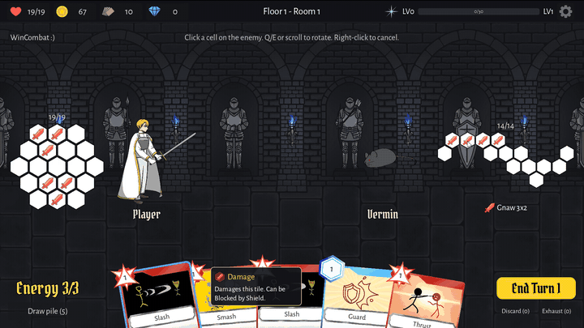
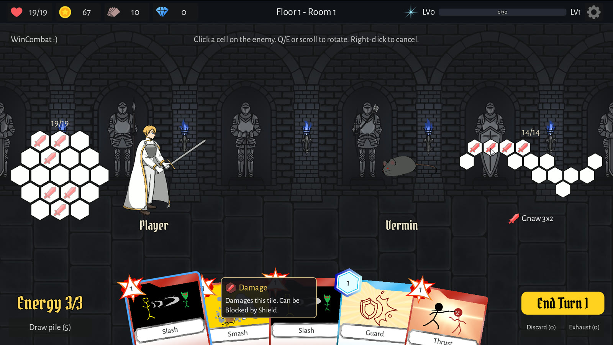
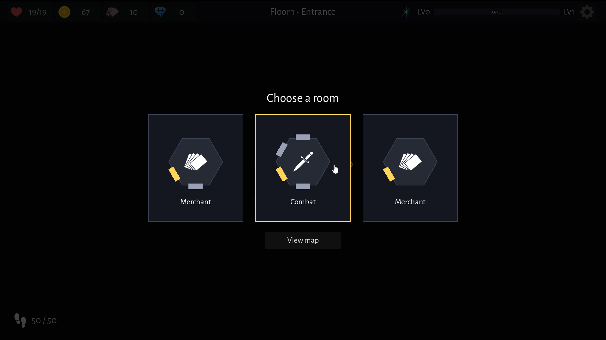
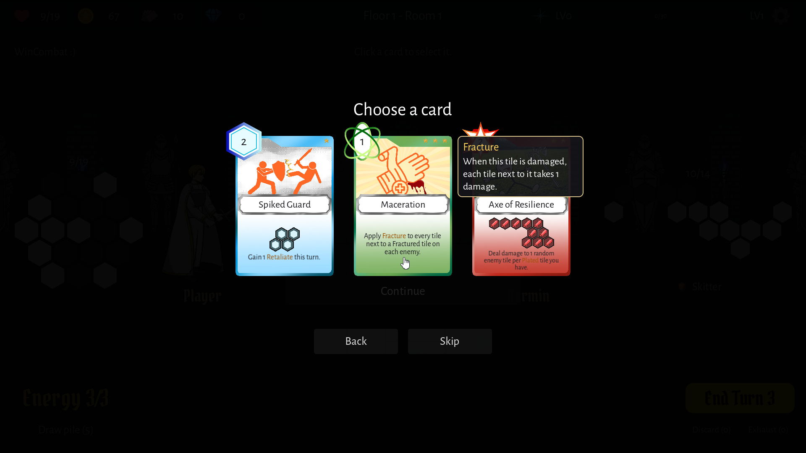

# HexSpire

A Slay the Spire–style deckbuilder where your health is a hex grid, and your cards hit tile patterns instead of single numbers.

## What makes it different

- **Health is a board of hexes.** Every hex is 1 HP. When an enemy hits you, the hexes it lands on are destroyed, so where you get hit matters as much as how much.
- **Enemies show their next move.** Each enemy telegraphs a pattern and a position before it acts. You see what's coming and plan your defence around it.
- **Cards are patterns.** An attack is a shape you place on the enemy's own hex board, and every hex it covers deals damage. Rotate it, aim it, and line up the shape you want. Defence works the same way: Shield and Plate cover chosen hexes on your board.

## How a run works

You climb three floors, a medieval castle, a halloween graveyard and a sci-fi lab, and each one ends in a boss.

The map isn't fixed. You build it as you go: at every doorway you pick one of a few rooms to open, and each room you build costs steps from a limited budget. Spend them on a short, safe route or push for the rooms you want. When the steps run out, the floor's boss finds you.

Rooms you can open include normal and elite fights, campfires, merchants, blacksmiths, treasure and random events.

Winning a fight pays out gold and XP, and lets you add a new card to your deck.

Between fights you shape your deck. Artifacts are relics you keep for the whole run, and augments are upgrades you attach to a single card, including extra hexes on its pattern. Beat the last boss to win.

## Team

DES486 Game Development

| Name | Role | Student ID |
|---|---|---|
| Phumipas Namjaidee | Game Director & Lead Developer | 6622781407 |
| Thanutch Mel Pholsukcharoen | Game Designer | 6622780870 |
| Phuwarit Kunlapan | Game Designer | 6622780045 |
| Pakkapol Maluangnont | Gameplay Developer | 6622780854 |
| Anna Wangsiri | Art Director | 6622771879 |

## Credits

Music and sound effects are CC0, from OpenGameArt.org and Kenney. See [CREDITS.md](CREDITS.md) for the full list.
